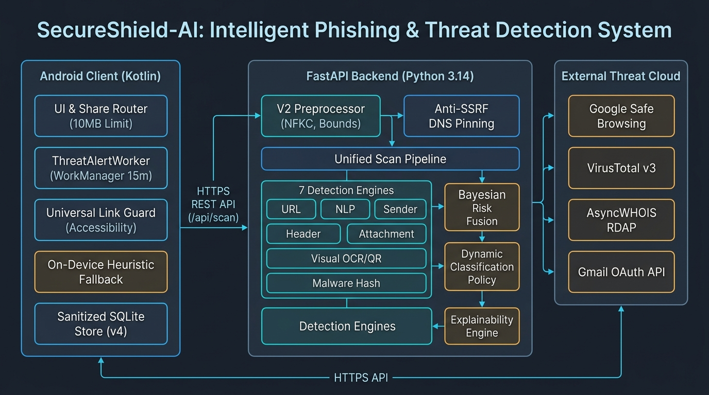
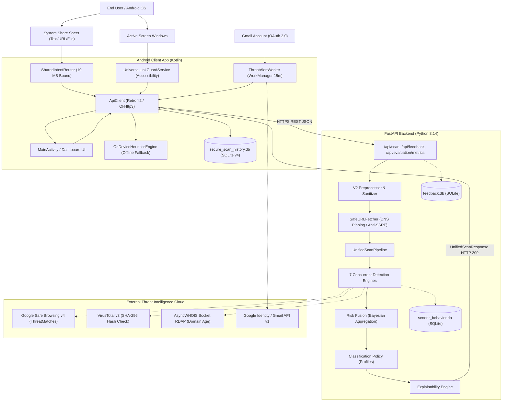
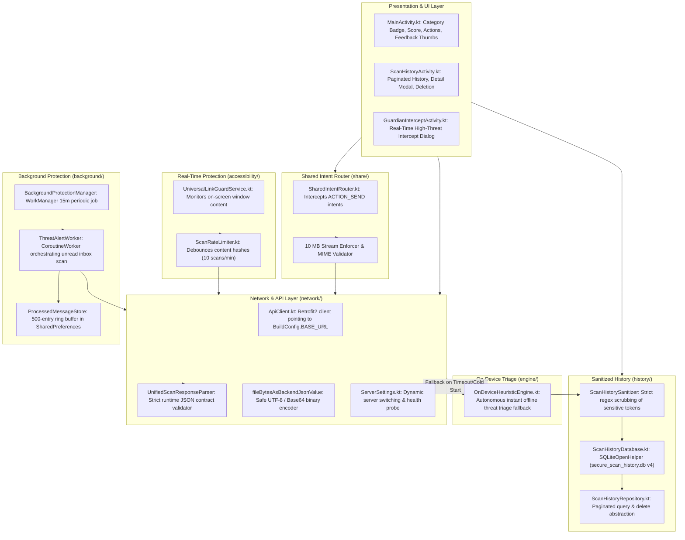
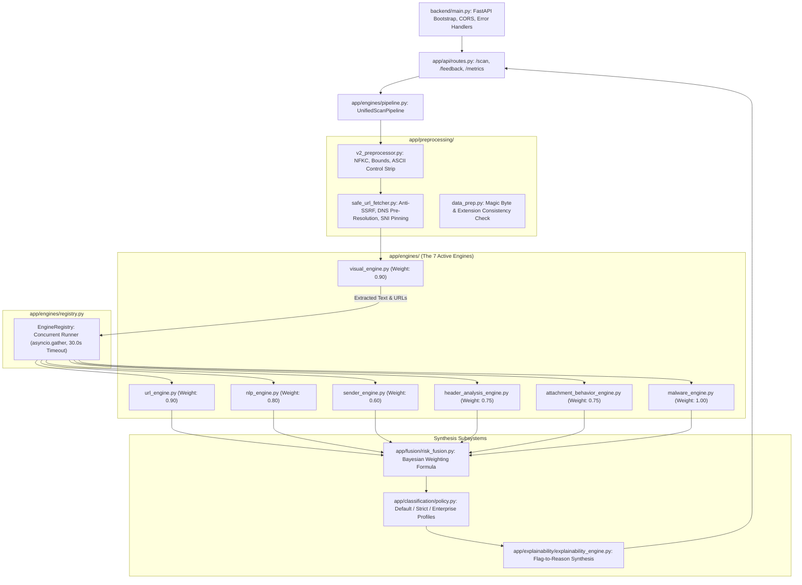
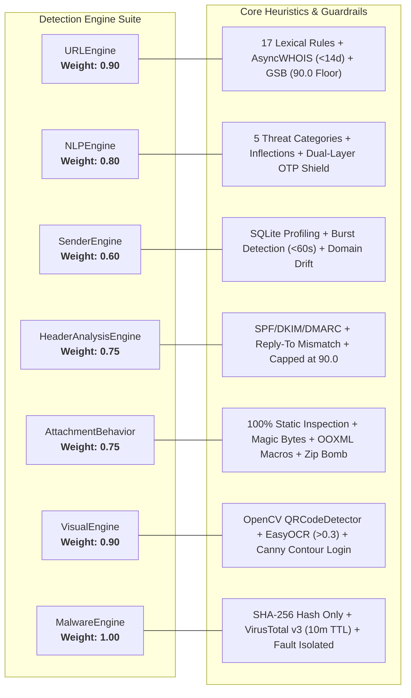
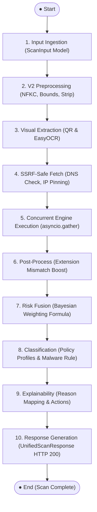
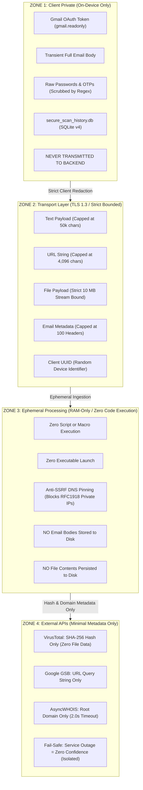

# SecureShield-AI — System Architecture Specification

**Intelligent Multi-Tiered Phishing & Threat Detection System**  
*A Cognitive Security Platform Integrating Parallel Detection Engines, Static Behavioral Intelligence, Bayesian Risk Fusion, and Deterministic Explainability.*

---

## Metadata & Executive Summary

| Attribute | Specification Details |
| :--- | :--- |
| **System Architecture Level** | Levels 1–4 (Context, Container, Component, Data Flow) |
| **Primary Target Evaluation** | Production Deployment, Technical Jury Review & Long-Term Maintenance |
| **Client Implementation** | Android Native (Kotlin 1.9, Retrofit 2.9, WorkManager 2.9, SQLite3, minSdk 24, targetSdk 34) |
| **Backend Implementation** | FastAPI 0.115, Python 3.14 / 3.11 Docker, AsyncIO, Pydantic v2 |
| **Active Detection Engines** | 7 Engines (URL, NLP, Sender, Header, Attachment, Vision, Malware) + 1 On-Device Fallback |
| **Automated Verification** | **325 Automated Tests Passing (100% Pass Rate)**: 205 Backend Tests + 120 Android Tests |
| **Classification Model** | Deterministic 5-Tier (`Safe`, `Suspicious`, `Deceptive`, `Phishing`, `Malware`) |
| **Verification Date** | October 2026 |

---

## 1. System Overview

SecureShield-AI is an advanced cybersecurity threat detection platform designed to protect end-users against modern social engineering, multi-stage phishing, weaponized document attachments, deceptive URLs, and visual credential harvesting. Modern adversaries rarely rely on a single obvious attack signature; instead, they blend urgent natural language phrasing, typosquatted hostnames, deceptive display names, disguised file formats, and deceptive visual login elements.

To counter these composite attacks, SecureShield-AI deploys a multi-modal ensemble of seven specialized detection and behavioral intelligence engines running concurrently within an asynchronous execution pipeline. Signals across text, URLs, file binaries, image payloads, email headers, and sender historical profiles are synthesized through a confidence-weighted Bayesian risk fusion layer, mapped against declarative risk classification policies, and interpreted by an explainability engine that outputs plain-language explanations and concrete user precautions. In addition, an autonomous on-device heuristic engine ensures zero-latency offline threat triage whenever cloud services are unreachable.

---

## 2. Foundational Architecture Principles

The design and implementation of SecureShield-AI strictly adhere to five foundational architectural principles:

| Quality Attribute | Architectural Principle | Implementation Evidence in Codebase |
| :--- | :--- | :--- |
| **Zero-Trust Input Normalization** | Treat all incoming inputs as malicious. Strictly bound payload lengths, sanitize characters, and prevent traversal before detection logic. | [`v2_preprocessor.py`](file:///d:/Secure%20Shield%20AI/backend/app/preprocessing/v2_preprocessor.py): caps text at 50,000 chars, URLs at 4,096 chars, files at 10 MB, and email headers at 100 items. Strips ASCII control chars and normalizes Unicode (NFKC). |
| **Fault-Tolerant Engine Isolation** | One engine's crash, external timeout, or missing API key must never fail the pipeline or distort other engine scores. | [`base_engine.py`](file:///d:/Secure%20Shield%20AI/backend/app/engines/base_engine.py): `BaseEngine.safe_analyze()` traps all unhandled exceptions into `ERROR` status. [`registry.py`](file:///d:/Secure%20Shield%20AI/backend/app/engines/registry.py): `EngineRegistry.run_all()` enforces 30.0s `asyncio.wait_for()`. |
| **Absence of Proof is Not Proof of Safety** | An engine that fails or times out must contribute zero confidence and be excluded from fusion, rather than scoring as 0/safe. | [`risk_fusion.py`](file:///d:/Secure%20Shield%20AI/backend/app/fusion/risk_fusion.py): `fuse_engine_results()` records errored/skipped engines in `ignored_engines`. Final scores are computed exclusively from usable engines (`SUCCESS` / `PARTIAL`). |
| **Privacy by Design & Edge Redaction** | Do not retain sensitive content on the backend. Redact sensitive secrets from scan history on the client before persisting. | [`feedback.py`](file:///d:/Secure%20Shield%20AI/backend/app/database/feedback.py): retains zero user text/files. Client [`ScanHistoryRecord.kt`](file:///d:/Secure%20Shield%20AI/android/app/src/main/java/com/secureshield/ai/history/ScanHistoryRecord.kt): `ScanHistorySanitizer` redacts passwords, OTPs, PINs, tokens, and phone numbers into `[redacted]` and `[number]`. |
| **Immutable Security Thresholds** | User feedback (thumbs up/down) must never automatically tune classification boundaries or lower threat detection barriers. | [`policy.py`](file:///d:/Secure%20Shield%20AI/backend/app/classification/policy.py): `apply_feedback_tuning()` explicitly raises `PermissionError`. Feedback is strictly isolated to offline evaluation telemetry. |

---

## 3. High-Level Architecture (Level 1: System Context)

The System Context diagram defines the boundaries of the SecureShield-AI platform, identifying all primary actors, runtime containers, and third-party security cloud services:

---

## 4. Component Architecture & Physical Topology

SecureShield-AI comprises two physical software containers alongside four persistent embedded SQLite storage instances:

| Container / Storage | Runtime Environment | Physical Repository Path | Core Interfaces & Responsibilities |
| :--- | :--- | :--- | :--- |
| **Android Client** | Android OS 7.0+ (ART runtime, SDK 24–34) | [`android/app/src/main/`](file:///d:/Secure%20Shield%20AI/android/app/src/main/) | `ACTION_SEND` Intent, Android Notification System (`SS_ALERTS`), WorkManager, Accessibility Service. |
| **FastAPI Backend** | Python 3.14 / 3.11 Docker (Uvicorn ASGI) | [`backend/app/`](file:///d:/Secure%20Shield%20AI/backend/app/), [`backend/main.py`](file:///d:/Secure%20Shield%20AI/backend/main.py) | HTTP/JSON REST API (`/api/scan`, `/api/feedback`, `/api/threat-intelligence/*`, `/api/evaluation/metrics`). |
| **Client History Store** | SQLite3 (`SQLiteOpenHelper`) | `secure_scan_history.db` (On-Device) | Schema Version 4. Offline local encrypted history managed by [`ScanHistoryRepository.kt`](file:///d:/Secure%20Shield%20AI/android/app/src/main/java/com/secureshield/ai/history/ScanHistoryRepository.kt). |
| **Sender Behavior DB** | SQLite3 (Local File) | [`backend/data/sender_behavior.db`](file:///d:/Secure%20Shield%20AI/backend/data/) | Tables `senders` and `sender_name_history` with compound primary keys `(client_id, sender_id)`. |
| **Feedback DB** | SQLite3 (Local File) | [`backend/data/feedback.db`](file:///d:/Secure%20Shield%20AI/backend/data/) | Normalized evaluation table `feedback` with unique index `idx_feedback_scan_id_unique`. |
| **Threat Intelligence DB** | SQLite3 (Local File) | [`backend/data/threat_feeds.db`](file:///d:/Secure%20Shield%20AI/backend/data/) | Verified real malware hashes (`malware_hashes`), live phishing/threat URLs (`threat_urls`), and top domain whitelist (`whitelisted_domains`). Zero-latency local indexed lookup. |

---

## 5. Android Client Architecture

The native Android mobile client is organized into modular architectural packages:

---

## 6. Backend Architecture & Module Topology

The FastAPI backend is structured into modular Python packages with strict boundaries separating normalization, detection, fusion, policy, and explainability:

---

## 7. The 7 Detection Engines: Heuristics & Weights

Every active engine evaluates a dedicated threat surface with empirical reliability weights:

### Detailed Engine Specifications

1. **[`url_engine.py`](file:///d:/Secure%20Shield%20AI/backend/app/engines/url_engine.py) (Weight: 0.90):**
   - **Verified Live Threat Feeds & Whitelisting:** Local indexed SQLite lookup against URLhaus and OpenPhish feeds. A confirmed malicious URL match enforces an immediate risk score of **100.0** and confidence **0.95**. Top trusted domains (Tranco/Umbrella whitelist) attenuate heuristic false alarms on benign enterprise domains.
   - **17 Lexical Heuristics:** Evaluates IP-based hosts, credential `@` injection, hyphen count ($\ge 3$), high-risk TLDs, URL shorteners, URL length ($\ge 75$), path depth ($\ge 20$), subdomain depth ($\ge 2$), security keywords, double slash redirects, plain HTTP, non-standard ports, HTTPS in hostname, Shannon entropy ($\ge 4.0$), digit-to-letter ratio ($\ge 0.2$), special characters, and Base64 query parameters.
   - **Domain Age:** Uses `asyncwhois` with a strict 2.0s timeout; flags domain age $< 14$ days as `newly_registered_domain`.
   - **Google Safe Browsing:** Queries `v4/threatMatches`. Positive match enforces a minimum threat score floor of **90.0**.

2. **[`nlp_engine.py`](file:///d:/Secure%20Shield%20AI/backend/app/engines/nlp_engine.py) (Weight: 0.80):**
   - **5 Threat Categories:** `urgency`, `credential_request`, `account_suspension`, `prize_lottery`, and `unusual_payment`.
   - **Inflection Regex:** Detects lexical variations (`suspended`, `locking`, `action required`, `wire transfers`).
   - **ADR-01 Dual-Layer OTP Shield:** Evaluates negative disclaimer regex `(?:do n't|never|should not) share` to suppress false alarms on legitimate 2FA notifications.

3. **[`sender_engine.py`](file:///d:/Secure%20Shield%20AI/backend/app/engines/sender_engine.py) (Weight: 0.60):**
   - **Behavioral Profiling:** Synchronously queries multi-tenant SQLite database `sender_behavior.db`.
   - **Anomalies Detected:** First-time senders, rapid transmission bursts ($< 60\text{s}$ window), unusual arrival hours, and sender domain drift.

4. **[`header_analysis_engine.py`](file:///d:/Secure%20Shield%20AI/backend/app/engines/header_analysis_engine.py) (Weight: 0.75):**
   - **Authentication Inspection:** Verifies SPF, DKIM, and DMARC verification headers.
   - **Mismatch Detection:** Flags domain discrepancies between `From`, `Reply-To`, and `Return-Path`.
   - **Score Cap:** Hard-capped at **90.0** to prevent header-only anomalies from classifying as Malware.

5. **[`attachment_behavior_engine.py`](file:///d:/Secure%20Shield%20AI/backend/app/engines/attachment_behavior_engine.py) (Weight: 0.75):**
   - **Safe Static Inspection:** Zero execution of macros, binaries, or scripts.
   - **File Structure Validation:** Magic byte vs. extension mismatches, double extensions (`.pdf.exe`), and Right-to-Left Override (RTLO) character attacks.
   - **Document & Archive Inspection:** Detects OOXML/OLE2 VBA macros, archive compression ratios $\ge 100:1$ (zip bombs), and excessive nesting depth.

6. **[`visual_engine.py`](file:///d:/Secure%20Shield%20AI/backend/app/engines/visual_engine.py) (Weight: 0.90):**
   - **QR Decoding:** Decodes embedded phishing URLs using OpenCV `QRCodeDetector`.
   - **OCR Extraction:** Uses EasyOCR with confidence threshold $> 0.3$.
   - **Canny Edge Contour Detection:** Analyzes geometric contour aspect ratios ($2.0 \le \text{aspect ratio} \le 20.0$) alongside credential keywords to identify fake login screenshots.
   - **ADR-03 Context Propagation:** Sequential execution feeds extracted URLs/text to downstream engines.

7. **[`malware_engine.py`](file:///d:/Secure%20Shield%20AI/backend/app/engines/malware_engine.py) (Weight: 1.00 — Highest Reliability):**
   - **Real-Time Threat Intelligence Database:** Zero-latency indexed check against `threat_feeds.db` pre-seeded with verified malware families (WannaCry, Emotet, Locky, RedLine Stealer, AgentTesla, Mirai, Mimikatz, EICAR) and synchronized with live daily MalwareBazaar signatures. A match yields risk score **100.0**, confidence **1.0**, and tags the specific threat family signature without requiring external cloud API keys.
   - **Hash-Only Lookup:** Computes SHA-256 and MD5 hashes in-memory; raw files are **never** uploaded to external clouds.
   - **VirusTotal v3 REST API:** Queries file hash with local 10-minute TTLCache (up to 1,000 hashes).
   - **Fault Isolation:** API timeout or rate-limit returns `EngineStatus.ERROR` with `confidence = 0.0`. Errored scans are excluded from Bayesian fusion and surface a top-level warning: *"malware scan unavailable"*.

---

## 8. End-to-End Scan Pipeline (10 Deterministic Stages)

Every scan follows a deterministic 10-stage pipeline:

### Key Pipeline Guarantees
1. **Sequential Visual Phase:** Visual extraction runs first so extracted QR URLs and OCR text dynamically populate `input_data.url` and `input_data.text` before parallel execution.
2. **Deterministic Parallel Branch:** All independent engines execute concurrently via `asyncio.gather()` wrapped in a 30.0s safety limit.
3. **Single-Pass Fusion:** Bayesian fusion runs exactly once per scan request.
4. **No False-Safe Distortion:** Errored or skipped engines contribute zero weight and are recorded in `ignored_engines`.

---

## 9. Risk Fusion & Dynamic Classification Architecture

### Mathematical Weighting Formula

$$\text{Weight}_i = \text{Confidence}_i \times \text{Reliability}_i \times \text{StatusFactor}_i$$

$$\text{Final Risk Score} = \frac{\sum (\text{RiskScore}_i \times \text{Weight}_i)}{\sum \text{Weight}_i} \quad \in [0.0, 100.0]$$

$$\text{Aggregate Confidence} = \min\left(1.0, \frac{\sum \text{Weight}_i}{\sum (\text{Reliability}_i \times \text{StatusFactor}_i)}\right)$$

Where:
- $\text{StatusFactor}_i = 1.0$ for `EngineStatus.SUCCESS`
- $\text{StatusFactor}_i = 0.5$ for `EngineStatus.PARTIAL`
- $\text{StatusFactor}_i = 0.0$ for `EngineStatus.ERROR` or `EngineStatus.SKIPPED` (captured in `ignored_engines`)

### Declarative Classification Profiles

[`policy.py`](file:///d:/Secure%20Shield%20AI/backend/app/classification/policy.py) maps unified risk scores into 5 discrete security tiers:

| Profile | Safe Upper | Suspicious Upper | Deceptive Upper | Phishing Upper | Malware Condition |
| :--- | :--- | :--- | :--- | :--- | :--- |
| **`default` (Standard)** | $< 20.0$ | $20.0 - 44.9$ | $45.0 - 69.9$ | $70.0 - 89.9$ | $\ge 90.0$ + Verified Malware Signal* |
| **`strict` (Heightened)** | $< 15.0$ | $15.0 - 34.9$ | $35.0 - 54.9$ | $55.0 - 79.9$ | $\ge 80.0$ + Verified Malware Signal* |
| **`enterprise` (Zero-Trust)** | $< 10.0$ | $10.0 - 29.9$ | $30.0 - 49.9$ | $50.0 - 74.9$ | $\ge 75.0$ + Verified Malware Signal* |

*\*Malware Safeguard (ADR-05): A score at or above the upper threshold will classify as `Phishing` unless a verified malware signal is confirmed (`vt_malicious`, `MALWARE`, `malware_detected`, or `malware_engine` risk score $\ge 90.0$ with confidence $\ge 0.5$).*

---

## 10. Explainability Architecture & Prescriptions

Located at [`explainability_engine.py`](file:///d:/Secure%20Shield%20AI/backend/app/explainability/explainability_engine.py), the explainability engine translates raw telemetry flags into human-understandable verdicts and concrete user precautions:

### Reason Synthesis Mapping
- `high_shannon_entropy` $\rightarrow$ *"The URL looks randomly generated."*
- `newly_registered_domain` $\rightarrow$ *"The domain is newly registered, which is common for short-lived malicious sites."*
- `ATTACHMENT_TYPE_MISMATCH` $\rightarrow$ *"The attachment extension does not match its true detected file type."*
- `DOUBLE_EXTENSION` $\rightarrow$ *"The attachment uses a deceptive double file extension to conceal its true format."*
- `MACRO_PRESENT` $\rightarrow$ *"The Office document attachment contains embedded VBA macros."*
- `ARCHIVE_EXPANSION_ANOMALY` $\rightarrow$ *"The archive exhibits an unusually large compression expansion ratio."*
- `visual_phishing_detected` $\rightarrow$ *"Image structurally resembles a credential-harvesting or fake login form."*

### Action Prescriptions
- **Safe:** *"Proceed with normal caution."* *(or "Proceed with caution. Malware scanning was unavailable for this file.")*
- **Suspicious:** *"Exercise caution. Do not share sensitive information unless you are certain of the source."*
- **Deceptive:** *"Do not trust this content. Avoid clicking links or downloading attachments."*
- **Phishing:** *"Do not click any links or provide credentials. Report and delete this message."*
- **Malware:** *"Do not open or execute file/link. Isolate and permanently delete the content immediately."*

---

## 11. Security & Privacy Architecture (4-Zone Isolation Matrix)

SecureShield-AI maintains strict physical and software boundaries across 4 distinct privacy zones:

---

## 12. External API Integration & Degraded Failure Behavior

| External Service | Protocol / Auth | Data Transmitted | Degraded / Outage Behavior |
| :--- | :--- | :--- | :--- |
| **Google Safe Browsing v4** | REST / API Key | Target URL string (JSON payload) | Status marked as `PARTIAL` with confidence 0.80. Falls back to 17 lexical rules and domain age without blocking pipeline. |
| **VirusTotal v3** | REST / API Key | SHA-256 binary hash string only | Returns `ERROR` + 0.0 confidence; isolated from fusion; surfaces top-level warning: *"malware scan unavailable"*. |
| **AsyncWHOIS RDAP** | Socket Port 43 | Root domain string (`example.com`) | Strict 2.0s timeout; treated as unknown domain age without throwing pipeline exceptions. |
| **Google Sign-In & Gmail** | OAuth 2.0 (`gmail.readonly`) | Client-side read token | Presents authentication dialog; offers simulated demo email scan fallback if cancelled. |

---

## 13. Error Handling & Resource Boundaries

| Failure / Boundary Condition | Protective Architectural Mechanism | System Behavior & User Experience |
| :--- | :--- | :--- |
| **VirusTotal API Unavailable / Timeout** | `MalwareEngine` traps network exceptions and returns `ERROR` status with confidence = 0.0. | Engine is ignored in Bayesian fusion. Score is computed from remaining engines. Injects top-level warning: *"malware scan unavailable"*. |
| **Google Safe Browsing Outage** | `URLEngine` records error, sets status to `PARTIAL` with confidence 0.80. | Falls back immediately to lexical heuristics and WHOIS domain age. Pipeline continues seamlessly. |
| **Hanging External WHOIS Server** | `_get_domain_age_days()` wraps socket query with `asyncio.wait_for(timeout=2.0)`. | Times out in 2.0s; domain age treated as unknown; URL engine completes without pipeline latency. |
| **Oversized Shared File (> 10 MB)** | Dual check: Android client buffer enforces 10 MB limit; `V2Preprocessor` rejects any payload $> 10,485,760$ bytes. | Immediate client rejection: *"Shared file is too large (maximum 10 MB)"*. Prevents server OOM exhaustion. |
| **SSRF / Private IP Spoofing** | `SafeURLFetcher` pre-resolves DNS before connecting, blocking loopback, RFC1918, link-local, and multicast IP ranges. | Blocks connection immediately. Connects directly to validated IP with Host/SNI headers to eliminate TOCTOU DNS rebinding. |
| **Double Feedback Vote Manipulation** | `FeedbackSubmissionManager` enforces thread-safe in-flight locks; backend enforces `scan_id` `UNIQUE` index. | Second submission returns HTTP 409 Conflict. UI dismisses cleanly without corrupting evaluation telemetry. |
| **Backend Sleep / Cold Start Latency** | Android `ApiClient` automatically falls back to `OnDeviceHeuristicEngine`. | Android user immediately receives on-device heuristic triage verdict without "Service Unavailable" errors. |

---

## 14. Deployment & Runtime Architecture

- **Backend Production Server:** Python 3.14 (or Python 3.11-slim container) running FastAPI under Uvicorn ASGI server. Container exposes port 8000 (dynamic `$PORT` bound in cloud PaaS: Render / Railway). Production deployments utilize reverse-proxy TLS termination (Nginx).
- **Android Application:** Configured with `minSdk = 24` (Android 7.0 Nougat) and `targetSdk = 34` / `compileSdk = 34` (Android 14). Configured with AndroidX WorkManager for background threat scans.
- **Environment Configuration:** Backend environment loaded via Pydantic `BaseSettings` from `.env` file (API keys, environment mode, port, rate limits).

---

## 15. Technology Stack Inventory

### Backend
- **Core Runtime:** Python 3.14.5 / Python 3.11-slim Docker container
- **Web Framework:** FastAPI 0.115, Uvicorn 0.32, Pydantic v2, Pydantic-Settings
- **Networking & Transport:** HTTPX 0.28, python-multipart
- **Vision & OCR:** OpenCV (`opencv-python-headless`), EasyOCR 1.7, PyTorch (CPU mode: `gpu=False`), NumPy
- **Threat Intelligence & Analysis:** AsyncWHOIS, TLDExtract, Cachetools, Filetype, SQLite3

### Android Native Client
- **Core Platform:** Kotlin 1.9, Java 17 JVM target, Android SDK 24–34
- **Networking & Serialization:** Retrofit 2.9, OkHttp 4.12, Okio 3.6, Gson 2.10
- **Background Execution:** AndroidX WorkManager 2.9, Kotlin Coroutines 1.7
- **Authentication & APIs:** Google Sign-In SDK, Google Play Services Auth 21.0, Google APIs Client for Gmail v1
- **UI & Accessibility:** ViewBinding, Material Components 1.11, NotificationCompat, Android Accessibility Framework
- **Local Persistence:** SQLite3 (`SQLiteOpenHelper`), SharedPreferences ring buffer

---

## 16. Architecture Decision Records (ADR Summary)

- **ADR-01: Dual-Layer OTP Defense Mechanism:** Requiring request verbs alone still flagged legitimate notices like *"Never share your OTP"*. The active architecture requires request verbs AND applies negative disclaimer suppression (`do not share`), eliminating false positives on 2FA notices.
- **ADR-02: Synchronous SSRF Pinning with SNI:** To eliminate TOCTOU DNS rebinding, `SafeURLFetcher` pre-resolves DNS, connects directly to the validated IP, and explicitly passes Host and SNI headers.
- **ADR-03: Two-Phase Sequential Visual Stage:** Visual extraction (QR/OCR) runs sequentially first so extracted text and URLs dynamically feed downstream engines before parallel execution.
- **ADR-04: Static-Only Attachment Inspection:** Zero dynamic code execution. All analysis is static inspection of binary headers, OLE streams, and archive structures.
- **ADR-05: Malware Signal Safeguard:** Scores alone cannot classify as Malware without verified telemetry from VirusTotal or malware flags.
- **ADR-06: Autonomous On-Device Fallback Engine:** Cloud sleeping/spin-down latency is mitigated by the client-side `OnDeviceHeuristicEngine`, ensuring 100% triage uptime.

---

## 17. Known Limitations & Mitigations

1. **CPU Vision Inference:** EasyOCR operates on CPU (`gpu=False`), requiring 2–4 seconds per high-resolution image scan. *Mitigation: Lazy-loaded reader and sequential pipeline execution with bounded image dimensions.*
2. **VirusTotal Quotas:** Free API tier permits 4 requests/minute. *Mitigation: In-memory 10-minute TTLCache (up to 1,000 hashes) prevents duplicate cloud queries.*
3. **Encrypted Archives:** Password-protected archives cannot have their internal files inspected statically. *Mitigation: Flagged as suspicious archive with user precautions provided.*
4. **Cloud Spin-Down Latency:** Free-tier cloud instances exhibit ~30–50s cold-start delays. *Mitigation: Client-side autonomous heuristic triage engine (`OnDeviceHeuristicEngine.kt`) triggers immediately upon network timeout.*

---

## 18. Appendix — Repository Component Directory

| Component Identifier | Repository Location | Primary Responsibility |
| :--- | :--- | :--- |
| **FastAPI Main Entry** | [`backend/main.py`](file:///d:/Secure%20Shield%20AI/backend/main.py) | Application bootstrap, CORS, exception handlers, health probe. |
| **API Endpoints** | [`backend/app/api/routes.py`](file:///d:/Secure%20Shield%20AI/backend/app/api/routes.py) | REST routes for `/api/scan`, `/api/feedback`, and `/api/evaluation/metrics`. |
| **Scan Input Model** | [`backend/app/models/scan_input.py`](file:///d:/Secure%20Shield%20AI/backend/app/models/scan_input.py) | Universal multi-modal data structure with Base64 binary decoding. |
| **Unified Response Model** | [`backend/app/models/scan_response.py`](file:///d:/Secure%20Shield%20AI/backend/app/models/scan_response.py) | Composite response model with score, classification, and warnings. |
| **V2 Preprocessor** | [`backend/app/preprocessing/v2_preprocessor.py`](file:///d:/Secure%20Shield%20AI/backend/app/preprocessing/v2_preprocessor.py) | Unicode NFKC sanitization, control-character stripping, 10 MB limits. |
| **SSRF Safe Fetcher** | [`backend/app/preprocessing/safe_url_fetcher.py`](file:///d:/Secure%20Shield%20AI/backend/app/preprocessing/safe_url_fetcher.py) | DNS pre-resolution, private IP blocking, SNI socket pinning. |
| **Unified Scan Pipeline** | [`backend/app/engines/pipeline.py`](file:///d:/Secure%20Shield%20AI/backend/app/engines/pipeline.py) | Multi-stage pipeline coordinator managing sequential & concurrent stages. |
| **Engine Registry** | [`backend/app/engines/registry.py`](file:///d:/Secure%20Shield%20AI/backend/app/engines/registry.py) | Thread-safe engine catalog with 30.0s bounded concurrent execution. |
| **Risk Fusion Engine** | [`backend/app/fusion/risk_fusion.py`](file:///d:/Secure%20Shield%20AI/backend/app/fusion/risk_fusion.py) | Confidence-weighted Bayesian score calculation and fault isolation. |
| **Classification Policy** | [`backend/app/classification/policy.py`](file:///d:/Secure%20Shield%20AI/backend/app/classification/policy.py) | Declarative 5-tier classification profiles & feedback immutability rule. |
| **Explainability Engine** | [`backend/app/explainability/explainability_engine.py`](file:///d:/Secure%20Shield%20AI/backend/app/explainability/explainability_engine.py) | Flag-to-reason synthesis and prescriptive actionable user safety advice. |
| **Feedback Database** | [`backend/app/database/feedback.py`](file:///d:/Secure%20Shield%20AI/backend/app/database/feedback.py) | Local SQLite persistence for evaluation telemetry with unique scan ID. |
| **Sender Behavioral DB** | [`backend/app/engines/sender_engine.py`](file:///d:/Secure%20Shield%20AI/backend/app/engines/sender_engine.py) | Local SQLite tracking of sender volume, bursts, and domain drift. |
| **Android Main UI** | [`MainActivity.kt`](file:///d:/Secure%20Shield%20AI/android/app/src/main/java/com/secureshield/ai/MainActivity.kt) | Threat verdict card, score gauge, action display, feedback submission. |
| **Shared Intent Router** | [`SharedIntentRouter.kt`](file:///d:/Secure%20Shield%20AI/android/app/src/main/java/com/secureshield/ai/share/SharedIntentRouter.kt) | `ACTION_SEND` MIME and stream routing with 10 MB boundary check. |
| **Threat Alert Worker** | [`ThreatAlertWorker.kt`](file:///d:/Secure%20Shield%20AI/android/app/src/main/java/com/secureshield/ai/background/ThreatAlertWorker.kt) | WorkManager periodic 15-minute background inbox check and notifications. |
| **Scan History Database** | [`ScanHistoryDatabase.kt`](file:///d:/Secure%20Shield%20AI/android/app/src/main/java/com/secureshield/ai/history/ScanHistoryDatabase.kt) | On-device sanitized SQLite history store (`secure_scan_history.db` v4). |
| **Scan History Sanitizer** | [`ScanHistoryRecord.kt`](file:///d:/Secure%20Shield%20AI/android/app/src/main/java/com/secureshield/ai/history/ScanHistoryRecord.kt) | Strict client-side regex scrubbing of passwords, OTPs, PINs, and tokens. |
| **Feedback Manager** | [`FeedbackSubmissionManager.kt`](file:///d:/Secure%20Shield%20AI/android/app/src/main/java/com/secureshield/ai/feedback/FeedbackSubmissionManager.kt) | Thread-safe in-flight vote locks and HTTP 409 conflict handling. |
| **Universal Link Guard** | [`UniversalLinkGuardService.kt`](file:///d:/Secure%20Shield%20AI/android/app/src/main/java/com/secureshield/ai/accessibility/UniversalLinkGuardService.kt) | Accessibility service monitoring active screen content in real time. |
| **On-Device Fallback** | [`OnDeviceHeuristicEngine.kt`](file:///d:/Secure%20Shield%20AI/android/app/src/main/java/com/secureshield/ai/engine/OnDeviceHeuristicEngine.kt) | Zero-latency on-device heuristic triage when cloud backend is offline. |
